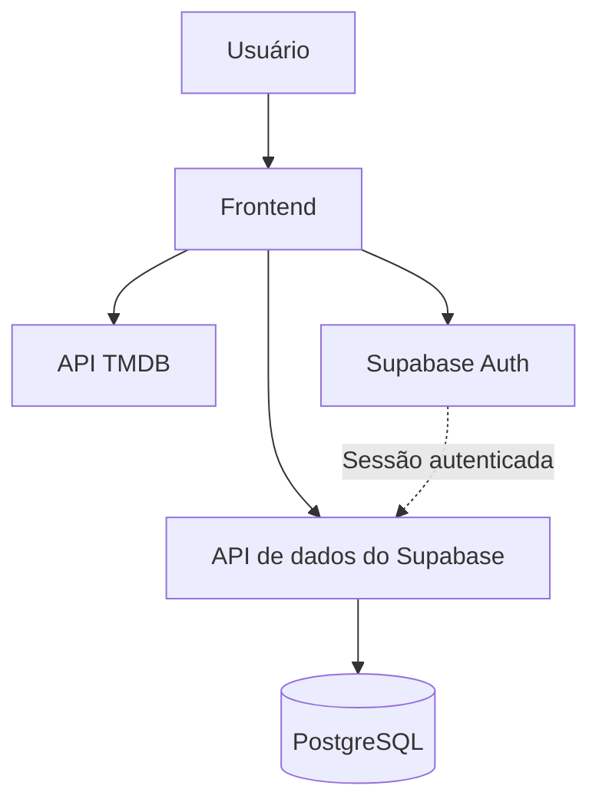

# Futura implementação — Autenticação e persistência em nuvem

## 1. Contexto

A versão inicial da aplicação de catálogo de séries utiliza a API do TMDB (The Movie Database) para consultar informações sobre os títulos e o `localStorage` do navegador para armazenar as preferências do usuário.

Essa abordagem permite disponibilizar as funcionalidades principais sem a necessidade de um servidor próprio, banco de dados externo ou sistema de autenticação.

**Status:** proposta de evolução futura, fora do escopo da implementação atual.

## 2. Implementação atual

O `localStorage` é utilizado como mecanismo de persistência local para armazenar:

- Identificador da série na API do TMDB;
- Inclusão na lista de séries para assistir;
- Marcação de séries assistidas;
- Marcação de séries favoritas;
- Avaliações individuais;
- Comentários pessoais.

As informações são associadas ao identificador de cada série, evitando a duplicação dos dados disponibilizados pela API do TMDB.

### 2.1. Limitações

- Os dados ficam restritos ao navegador, dispositivo e origem da aplicação;
- Não existe autenticação real de usuários;
- Não há sincronização automática entre dispositivos;
- Os registros podem ser perdidos caso o armazenamento do site seja limpo;
- O armazenamento local não é adequado para guardar senhas ou informações sensíveis.

## 3. Proposta de implementação futura

Como alternativa ao `localStorage`, propõe-se a integração com o **Supabase**, plataforma de Backend as a Service (BaaS) que disponibiliza autenticação, banco de dados PostgreSQL e APIs de acesso aos dados.

A proposta consiste em permitir que cada usuário possua uma conta individual e mantenha suas preferências armazenadas em nuvem, independentemente do dispositivo utilizado.

O Supabase é a alternativa preferencial por reunir autenticação e banco de dados relacional em um mesmo serviço, sem exigir o desenvolvimento de um backend próprio para essas funcionalidades.

A utilização de seu plano gratuito deverá ser avaliada no momento da implementação, considerando os limites e termos vigentes.

## 4. Funcionalidades previstas

- Cadastro de usuários com e-mail e senha;
- Login e logout;
- Recuperação de senha;
- Gerenciamento de sessões;
- Persistência das listas, favoritos, avaliações e comentários em banco de dados;
- Sincronização dos dados entre dispositivos;
- Isolamento dos registros de cada usuário;
- Possibilidade de importação dos registros anteriormente armazenados no `localStorage`.

A integração com provedores externos de autenticação, como o Google, poderá ser considerada posteriormente, sem constituir requisito obrigatório da primeira versão autenticada.

## 5. Arquitetura proposta

| Componente | Responsabilidade |
| --- | --- |
| Frontend | Interface, autenticação e gerenciamento das preferências |
| API TMDB | Consulta de séries, imagens, sinopses e demais informações dos títulos |
| Supabase Auth | Cadastro, autenticação e gerenciamento de sessões |
| PostgreSQL | Armazenamento persistente das preferências individuais |
| localStorage | Preferências locais de interface e, opcionalmente, dados de visitantes |

A API do TMDB continuará sendo a fonte principal dos dados das séries. O banco de dados armazenará apenas os identificadores dos títulos e as informações personalizadas pelos usuários.

## 6. Modelagem preliminar do banco de dados

### 6.1. Usuários — `auth.users`

Tabela gerenciada pelo próprio Supabase Auth, responsável pelos registros das contas e pela autenticação. Não será necessário criar uma tabela própria para armazenar senhas.

### 6.2. Preferências — `user_series`

| Campo | Tipo PostgreSQL | Descrição |
| --- | --- | --- |
| `id` | UUID | Identificador único do registro |
| `user_id` | UUID | Referência ao usuário autenticado |
| `tmdb_id` | INTEGER | Identificador da série no TMDB |
| `watchlist` | BOOLEAN | Indica inclusão na lista para assistir |
| `watched` | BOOLEAN | Indica se a série foi assistida |
| `favorite` | BOOLEAN | Indica se a série é favorita |
| `rating` | INTEGER | Avaliação individual, opcional |
| `comment` | TEXT | Comentário pessoal, opcional |
| `created_at` | TIMESTAMPTZ | Data de criação |
| `updated_at` | TIMESTAMPTZ | Data da última atualização |

Regras previstas:

- Chave primária em `id`;
- Chave estrangeira de `user_id` para `auth.users.id`;
- Restrição de unicidade composta por `user_id` e `tmdb_id`;
- Validação da avaliação conforme a escala adotada na aplicação;
- Valores booleanos com padrão `false`.

A modelagem é preliminar e poderá ser ajustada conforme a estrutura existente na aplicação.

## 7. Segurança e controle de acesso

A implementação deverá utilizar Row Level Security (RLS) no PostgreSQL para garantir que cada usuário possa consultar, inserir, atualizar e excluir exclusivamente os próprios registros. As políticas deverão validar a correspondência entre `auth.uid()` e `user_id`, incluindo a validação dos dados inseridos ou atualizados.

O frontend deverá utilizar somente a chave pública apropriada do Supabase. Chaves administrativas ou privilegiadas não poderão ser incluídas no código distribuído ao navegador, nem versionadas no repositório. Senhas serão gerenciadas pelo serviço de autenticação.

## 8. Estratégia de evolução e migração

A implementação atual poderá ser mantida sem alterações obrigatórias. Quando a evolução for priorizada, recomenda-se executar as seguintes etapas:

1. Identificar como o frontend acessa e modifica os dados do `localStorage`.
2. Centralizar as operações de persistência em uma camada de serviço, caso ainda não exista.
3. Criar e configurar o projeto no Supabase.
4. Implementar a tabela de preferências e as políticas de segurança.
5. Desenvolver as telas e os fluxos de autenticação.
6. Criar a integração do frontend com a persistência remota.
7. Disponibilizar uma importação opcional dos dados locais após o login, mediante confirmação do usuário.
8. Evitar duplicidades utilizando a chave composta por usuário e série. Em caso de conflito, preservar os dados remotos até que o usuário escolha como conciliá-los.
9. Validar os registros importados antes de permitir a remoção dos dados locais.
10. Testar a persistência, a sincronização e o isolamento entre contas.

A camada de persistência deverá permitir a substituição do armazenamento local pelo remoto sem exigir a reimplementação das funcionalidades do catálogo. Se o modo visitante for mantido, os dados locais deverão permanecer separados dos dados das contas autenticadas.

## 9. Alternativas tecnológicas

| Tecnologia | Autenticação | Banco de dados | Considerações |
| --- | --- | --- | --- |
| Supabase | Integrada | PostgreSQL | Alternativa preferencial pela estrutura relacional e integração dos serviços |
| Firebase | Integrada | Cloud Firestore (NoSQL) | Alternativa para uma modelagem orientada a documentos |
| Appwrite | Integrada | Serviço de banco de dados próprio | Alternativa com serviços de backend integrados |
| PocketBase | Integrada | SQLite | Alternativa leve, mas exige infraestrutura para hospedagem e manutenção |

A escolha definitiva dependerá dos requisitos, custos, limites dos planos gratuitos e condições de hospedagem no momento da evolução.

## 10. Critérios de aceite da implementação futura

- [ ] O usuário consegue criar uma conta, entrar e sair da aplicação.
- [ ] As preferências permanecem disponíveis após um novo login.
- [ ] Os registros podem ser consultados em outro dispositivo.
- [ ] Cada usuário possui acesso somente aos próprios dados.
- [ ] Não existem registros duplicados para uma mesma série e usuário.
- [ ] A integração com o TMDB permanece funcional.
- [ ] A importação opcional dos dados locais não provoca perda de registros.
- [ ] Nenhuma credencial administrativa é exposta no frontend.
- [ ] Falhas de autenticação e de comunicação com o banco são tratadas adequadamente.

## 11. Referências técnicas

- Supabase: https://supabase.com/docs
- Supabase Auth: https://supabase.com/docs/guides/auth
- Row Level Security: https://supabase.com/docs/guides/database/postgres/row-level-security
- Planos do Supabase: https://supabase.com/pricing
- Firebase: https://firebase.google.com/docs
- Appwrite: https://appwrite.io/docs
- PocketBase: https://pocketbase.io/docs/

## 12. Considerações finais

A utilização do `localStorage` permanece como solução de persistência da versão atual, priorizando a simplicidade e reduzindo a complexidade do desenvolvimento inicial.

A integração com o Supabase é registrada exclusivamente como possibilidade de evolução futura, permitindo a introdução de autenticação real, persistência em nuvem e sincronização entre dispositivos quando houver necessidade.

Este documento não determina a execução imediata das atividades propostas, não implica contratação de serviços e não altera o escopo atual do projeto.
